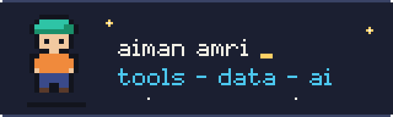
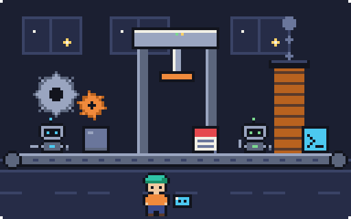

<picture><source media="(prefers-reduced-motion: reduce)" srcset="assets/logo-still.png"></picture>

  <strong>Developer based in Kuala Lumpur, Malaysia</strong> 
  I build developer tools, data pipelines and small web apps, and I work with Claude Code every day.

  
  

🔭 Currently building automation workflows for daily work with Google Apps Script. 
🌱 Currently learning prompt and context engineering.

  
  
  

I like tools that run locally, ship without a backend when they can, and are easy to self-host. Most of what's below is a browser app, a small Docker setup or a data project I built to learn something properly. I'm comfortable in JavaScript and Python, and I'm still growing in data engineering and AI tooling.

## Featured projects

<table>
<tr>
<td width="50%" valign="top">
<picture><source media="(prefers-reduced-motion: reduce)" srcset="assets/factory-still.png"></picture>
<h3><a href="https://github.com/aimanamri/dev-tools">dev-tools</a></h3>

19 client-side developer utilities: JSON, PDF, QR codes, timestamps, a subnet calculator, Markdown and more. Everything runs in the browser, with no server and no tracking. Deploy it on a static host or in Docker.

<strong>React · Vite · Docker</strong>

</td>
<td width="50%" valign="top">
<picture><source media="(prefers-reduced-motion: reduce)" srcset="assets/kb-still.png"></picture>
<h3><a href="https://github.com/aimanamri/bento-os">bento-os</a></h3>

A personal knowledge base, prompt library and snippet manager in one macOS-style window. No framework, self-hostable with Docker and PostgreSQL, in English, 日本語 and Bahasa Melayu.

<strong>JavaScript · PostgreSQL · Docker</strong>

</td>
</tr>
<tr>
<td width="50%" valign="top">
<picture><source media="(prefers-reduced-motion: reduce)" srcset="assets/data-still.png"></picture>
<h3><a href="https://github.com/aimanamri/raspberry-pi4-hadoop-spark-cluster">raspberry-pi4-hadoop-spark-cluster</a></h3>

A written-up build of a 3-node Raspberry Pi 4 cluster: HDFS, Spark jobs on YARN, and Linux admin along the way.

<strong>Hadoop · Spark · Shell · Linux</strong>

</td>
<td width="50%" valign="top">
<picture><source media="(prefers-reduced-motion: reduce)" srcset="assets/mech-still.png"></picture>
<h3><a href="https://github.com/aimanamri/mechanicalEngineering">mechanicalEngineering</a></h3>

Engineering calculations in Python: Mohr's circle, von Mises stress, beam SFD/BMD, Rankine and refrigeration cycles, damped vibration and numerical methods, as Jupyter notebooks.

<strong>Python · Jupyter · NumPy</strong>

</td>
</tr>
</table>

## More things I've built

| Project | What it is |
| --- | --- |
| [docker-playground](https://github.com/aimanamri/docker-playground) | A local Docker playground for SQL and PySpark: MySQL, PostgreSQL, phpMyAdmin, pgAdmin and Jupyter. |
| [yellow-taxi-trips-etl-data-engineering-project](https://github.com/aimanamri/yellow-taxi-trips-etl-data-engineering-project) | An ETL data engineering project on NYC yellow taxi trip data. |
| [claude-dev-exam-prep](https://github.com/aimanamri/claude-dev-exam-prep) | Study material for a Claude developer exam. |
| [HabTracker](https://github.com/aimanamri/HabTracker) | A habit tracker in TypeScript. |
| [habbo-player-info](https://github.com/aimanamri/habbo-player-info) | Reads player attributes from Habbo Hotel's public API. |
| [canva-button-hider-chrome-extension](https://github.com/aimanamri/canva-button-hider-chrome-extension) | A Chrome extension that hides the "Send to teacher" button on Canva Education. |
| [streamlit-app](https://github.com/aimanamri/streamlit-app) | A few small data apps built with Streamlit. |
| [COVID-19-Analysis](https://github.com/aimanamri/COVID-19-Analysis) | Daily-updated Malaysia and Japan COVID-19 data with notebooks. |
| [git-action-test-automated_workflow](https://github.com/aimanamri/git-action-test-automated_workflow) | Automated versioning with Commitizen and a bump workflow on GitHub Actions. |

Earlier practice repos

[javascript-projects](https://github.com/aimanamri/javascript-projects) · [website-design](https://github.com/aimanamri/website-design) · [php-form](https://github.com/aimanamri/php-form) · [bash-script](https://github.com/aimanamri/bash-script) · [py-beginnerproject](https://github.com/aimanamri/py-beginnerproject) · [Fortran90-assignments](https://github.com/aimanamri/Fortran90-assignments)

## Toolkit

<strong>Languages</strong>

  
  
  
  
  
  

<strong>Web</strong>

  
  
  
  
  
  
  
  
  
  
  

<strong>Data &amp; infrastructure</strong>

  
  
  
  
  
  
  
  
  
  
  
  

<strong>Workflow &amp; AI tooling</strong>

  
  
  
  
  

## GitHub stats

  
  

  Kuala Lumpur · English, 日本語, Bahasa Melayu

